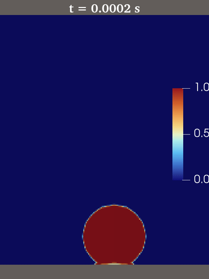
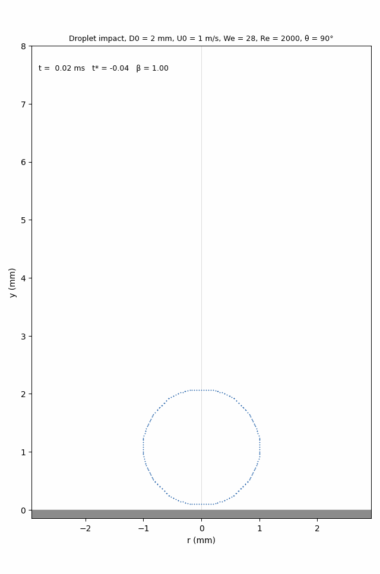
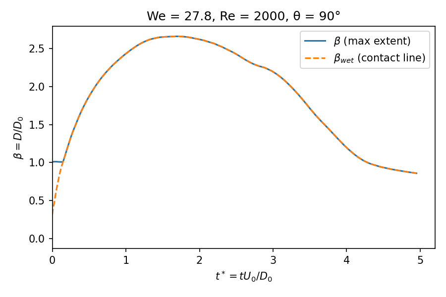
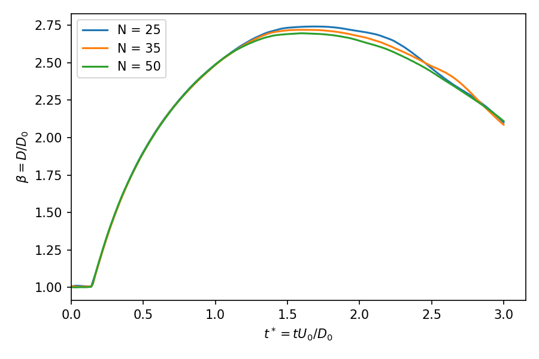
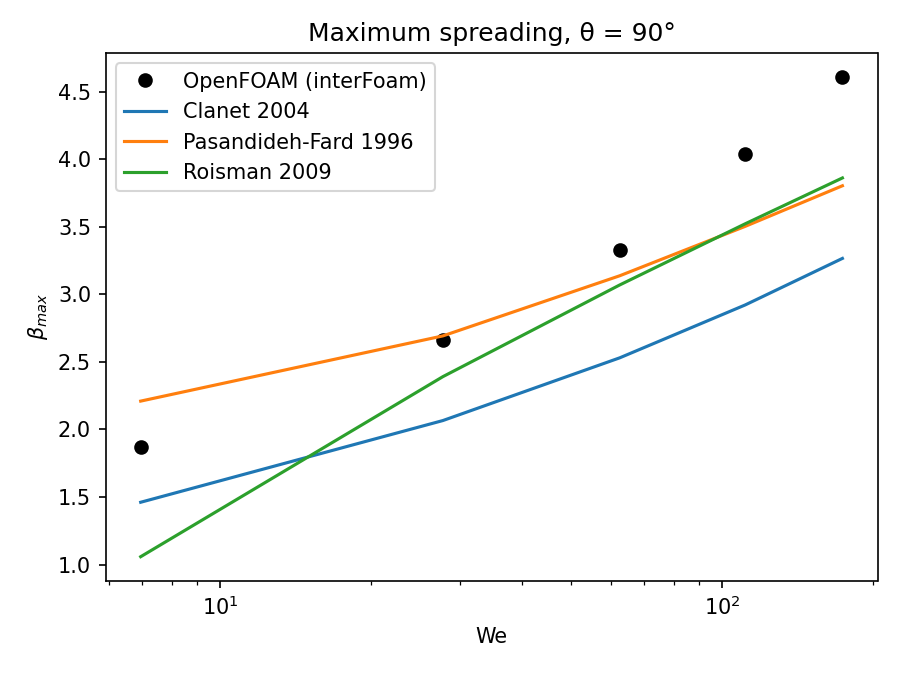
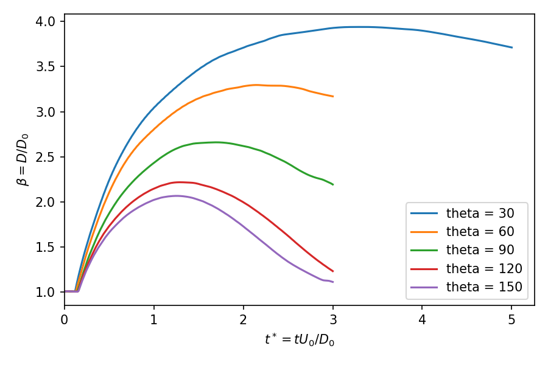
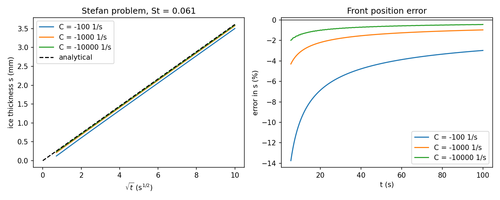
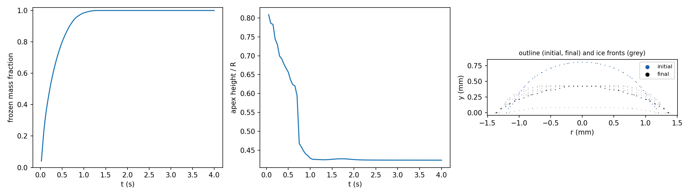

# Droplet impact and icing in OpenFOAM

Simulations of water droplets impacting surfaces of controlled wettability, built step by step towards droplet freezing on cold surfaces, the process behind aircraft and wind-turbine icing. The work uses OpenFOAM (v2606, openfoam.com) with volume-of-fluid interface capturing, and is aimed at the question of how the wall, through its wettability, its contact-line dynamics and later its temperature, controls spreading and freezing.

<table align="center">
<tr>
<td align="center"><br><sub>Water volume fraction (ParaView)</sub></td>
<td align="center"><br><sub>α = 0.5 interface (<code>postProcess/animate.py</code>)</sub></td>
</tr>
</table>

*Water volume fraction for a 2 mm water droplet hitting a wall at 1 m/s (We = 28, Re = 2000, θ = 90°), axisymmetric `interFoam` run mirrored about the axis; left from ParaView, right drawn from the interface data without ParaView. The droplet spreads into a lamella with an air bubble trapped at the centre, recoils, opens a dry spot on the axis whose collapse drives a thin jet, and the jet breaks into satellite droplets.*

## Status

| Phase | Content | Status |
|---|---|---|
| 1 | Isothermal axisymmetric impact (`interFoam`), comparison with spreading correlations, mesh study | Done; β_max not mesh-converged (see 1b) |
| 1b | Wall-region resolution: imposed Navier slip length (done), wall-graded mesh (next) | In progress |
| 1c | Weber-number sweep (We = 7–174) | Done; resolution-limited above We ≈ 60 |
| 2 | Wettability sweep at We = 28 (θ = 30°–150°) | Done; rebound regime planned |
| 3 | Dynamic contact-angle boundary condition from molecular-kinetic theory (C++ library) | Planned |
| 4a | Freezing verification: 1D Stefan problem with `icoReactingMultiphaseInterFoam` | Done |
| 4b | Sessile droplet freezing on a cold plate (water, ice, air; ice expansion) | Paused: diagnosis below |
| 4c | Droplet impact on a cold plate | Planned |
| 5 | 3D impact with adaptive mesh refinement, parallel scaling | Planned |

## Phase 1 results

A 2 mm water droplet hits a flat wall at 1 m/s in air, with a static contact angle of 90° (We = ρU₀²D₀/σ = 27.8, Re = U₀D₀/ν = 2000). The spreading factor β = D/D₀ is measured from the α = 0.5 interface, and time is t* = tU₀/D₀ from contact.

| Mesh | Cells per radius | Δx (µm) | β_max | t* at β_max | vs Pasandideh-Fard (1996) |
|---|---|---|---|---|---|
| N25 | 25 | 40 | 2.661 | 1.70 | −1.2 % |
| N35 | 35 | 29 | 2.640 | 1.63 | −2.0 % |
| N50 | 50 | 20 | 2.608 | 1.57 | −3.2 % |

For comparison, the correlations of Clanet et al. (2004) and Roisman (2009) give 2.07 and 2.39. Clanet's scaling was derived mainly for non-wetting surfaces, which explains most of that gap. Pasandideh-Fard's energy balance includes the contact angle and is the closest reference here.


**Findings**

- Early spreading (t* < 1) is the same on all three meshes, and recoil converges (N35 and N50 differ by 0.015 at t* = 3).
- β_max does **not** converge. It falls by about 1 % per refinement, with growing differences (0.021, then 0.032). Two mechanisms fit, both making coarse meshes overpredict spreading:
  1. numerical contact-line slip, since on a no-slip wall the contact line moves by about one cell;
  2. an under-resolved wall boundary layer, δ ≈ D₀/√Re ≈ 45 µm, covered by only one or two cells.

  Phase 1b tests them (below).
- Liquid volume is conserved to better than 0.001 % through maximum spread.
- During recoil at θ = 90°, the collapsing cavity drives a thin axial jet rising at about 4 m/s (4 U₀). Its radius is close to the cell size, so its speed is not resolved, and volume loss starts when it forms (−0.085 % by 10 ms). Validation runs therefore stop at t* = 3.
- β_max is independent of domain height (identical in 4 mm and 8 mm domains).
- The animation shows a small air bubble trapped on the axis at the wall from the moment of impact, consistent with the air cushion being enclosed under the droplet (Thoroddsen et al. 2005). At N25 it spans only a few cells, so its size is not resolved.
- The axial jet breaks into satellite droplets (three by t ≈ 9 ms). The jet and these droplets are a few cells across, which is where the late volume loss occurs.
- The jet forms after the recoiling film opens a dry spot on the axis (t ≈ 6 ms) and the cavity collapses, the mechanism described by Bartolo et al. (2006).

The full impact, including recoil, from an earlier exploratory run to t* = 5 (N25, 4 mm tall domain, otherwise identical):



Data: [`results/mesh_study.csv`](results/mesh_study.csv)

### Phase 1b: imposed slip length

The mesh study was repeated with a Navier slip length λ = 20 µm, u_wall = λ ∂u/∂n, applied as `partialSlip` with valueFraction = (Δy/2)/(λ + Δy/2) on each mesh. If the drift came from numerical contact-line slip, a fixed physical slip length should have removed it.

| Mesh | β_max, no-slip | β_max, λ = 20 µm | Shift |
|---|---|---|---|
| N25 | 2.661 | 2.741 | +3.0 % |
| N35 | 2.640 | 2.719 | +3.0 % |
| N50 | 2.608 | 2.696 | +3.4 % |



Slip raises β_max by about 3 % on every mesh, as expected from the lower wall dissipation, but β_max still falls by about 0.8 % per refinement (steps of −0.022 and −0.023, against −0.021 and −0.032 without slip). Fixing the slip length removed the growth of the steps but not the drift. Numerical contact-line slip is therefore not the main cause; the remaining drift points to under-resolution of the wall boundary layer and the thinning lamella. Recoil converges (the curves meet at t* ≈ 2.9). The near-exact agreement with Pasandideh-Fard at N50 (+0.1 %) should not be over-read, since the model itself is accurate to about ±10 %. The next test is a mesh refined only near the wall.

Data: [`results/mesh_study_slip20um.csv`](results/mesh_study_slip20um.csv)

## Weber-number sweep (Phase 1c)

U₀ = 0.5–2.5 m/s at θ = 90° and N25 (40 µm cells), run to t* = 5 so that every maximum is captured.

| We | Re | β_max | Pasandideh-Fard | Roisman | Clanet | vs Pasandideh-Fard |
|---|---|---|---|---|---|---|
| 6.9 | 1000 | 1.87 | 2.21 | 1.06 | 1.46 | −15.3 % |
| 27.8 | 2000 | 2.66 | 2.69 | 2.39 | 2.07 | −1.2 % |
| 62.5 | 3000 | 3.33 | 3.14 | 3.07 | 2.53 | +6.1 % |
| 111.1 | 4000 | 4.04 | 3.50 | 3.52 | 2.92 | +15.3 % |
| 173.6 | 5000 | 4.61 | 3.81 | 3.86 | 3.27 | +21.2 % |



β_max rises with We as in all three correlations, with a fitted exponent of 0.26 between We = 7 and 62 (Clanet's capillary scaling gives 1/4). At low We the energy-balance and viscous correlations are outside their range of validity. Above We ≈ 60 the simulation overpredicts by 15–21 % and the maximum is reached late (t* = 4.6 at We = 111, where experiments usually give t* ≈ 2–3). At these Reynolds numbers the boundary layer (δ ≈ D₀/√Re = 28–32 µm) is thinner than one 40 µm cell and the lamella near maximum spread is about two cells thick, so wall friction is underestimated and the film keeps creeping. This is the same wall-resolution effect identified in Phase 1b, at its strongest. High-We runs need a wall-refined mesh before they can be compared quantitatively.

Data: [`results/weber_sweep.csv`](results/weber_sweep.csv)

## Wettability sweep (Phase 2)

θ = 30°–150° at We = 28, N25.

| θ | β_max | t* at β_max | Pasandideh-Fard | Difference |
|---|---|---|---|---|
| 30° | 3.94 | 3.33 | 3.71 | +6.1 % |
| 60° | 3.30 | 2.15 | 3.16 | +4.3 % |
| 90° | 2.66 | 1.70 | 2.69 | −1.2 % |
| 120° | 2.22 | 1.29 | 2.39 | −7.0 % |
| 150° | 2.07 | 1.26 | 2.22 | −6.8 % |



Pasandideh-Fard's energy balance, the only correlation with a contact-angle term, stays within ±7 % from strongly wetting to strongly non-wetting walls. At 150° the result matches Clanet's correlation (2.07 against 2.066), consistent with that scaling having been derived on superhydrophobic surfaces. Wettability also sets the recoil: at θ ≥ 120° the droplet retracts to β ≈ 1.1–1.2 by t* = 3, heading towards rebound, while at 30° it keeps spreading until t* ≈ 3.3 and retracts only slightly.

Data: [`results/theta_sweep.csv`](results/theta_sweep.csv)

## Freezing verification (Phase 4a)

Water at 0 °C in a 10 mm column is frozen from a wall held at −10 °C (`cases/stefan_freezing_1d`). The solver is `icoReactingMultiphaseInterFoam` with water and ice as phases, the Lee phase-change model (liquid to solid, active below 0 °C) and Voller-Prakash damping in the ice. Ice and water densities are set equal so that freezing causes no flow, as the analytical solution assumes. The exact front position is s(t) = 2λ√(α_ice t), with λ e^{λ²} erf(λ) = St/√π; here St = 0.061 and s = 0.361 mm √(t/s).

| Lee coefficient C (1/s) | s at 100 s (mm) | Exact (mm) | Error |
|---|---|---|---|
| −100 | 3.502 | 3.610 | −2.97 % |
| −1000 | 3.575 | 3.610 | −0.97 % |
| −10000 | 3.594 | 3.610 | −0.43 % |



The Lee model freezes water at a rate proportional to its undercooling, so the front runs slightly behind the exact solution. The lag is fixed early (the curves are parallel in √t), so the relative error decays over time. It falls with |C|, but by less than a factor of 10 per decade, which suggests a second error source (the 50 µm cells, 1.4 % of the final thickness) dominates at C = −10000. C = −1000 is used for the droplet cases as a compromise between accuracy and time step.

Data: [`results/stefan_C.csv`](results/stefan_C.csv)

## Sessile droplet freezing (Phase 4b): diagnosis

A water droplet (R = 1 mm, 90° hemisphere at 0 °C) on a plate at −30 °C, with air, water and ice as three phases in `icoReactingMultiphaseInterFoam` (`cases/sessile_drop_freezing`, 14 cells per radius, limited by the explicit surface-tension time step). The case is not yet physical, and the tests below isolate why.

| Test | Result |
|---|---|
| No freezing (plate at 0 °C), 0.1 s | Hemisphere holds (apex 0.97 R), mass conserved: the three-phase setup and surface tension are sound |
| Freezing, first 0.1 s | Contact line advances from 1.0 to 1.33 mm as soon as ice forms (2 % frozen at 0.01 s); a real droplet pins its contact line |
| Full run | Freezes in about 1 s into a flat cap (apex 0.35 R); ice mass keeps falling after the drop is fully frozen (−11 % at 1.2 s, −39 % at 3.7 s) |
| + Darcy damping on the ice-air pair | Loss halved (−5 % at 1.2 s, −28 % at 4 s) but continues after full freezing |
| + equal ice and water densities | Same spreading and loss, so neither is caused by the 9 % expansion |



The leak is numerical and tied to the static ice phase where it meets air; the spreading appears as soon as ice forms at the contact line. The next step is to keep water and ice in one volume-of-fluid phase (`interFoam` with an energy equation and enthalpy-porosity freezing restricted to the liquid), so that freezing cannot change the phase volume and mass is conserved by construction. Phase 4a remains the validated freezing result.

Data: [`results/freezing_mass.csv`](results/freezing_mass.csv)

## Model

| Item | Choice |
|---|---|
| Solver | `interFoam`: incompressible two-phase Navier-Stokes, algebraic VOF with MULES and interface compression |
| Surface tension | Continuum surface force (Brackbill et al. 1992) |
| Wall | No-slip, `constantAlphaContactAngle` |
| Geometry | 2D axisymmetric 5° wedge, r = 0–6 mm, y = 0–8 mm, square cells |
| Time step | Adaptive, Courant ≤ 0.2, Δt ≤ 0.6 × capillary limit √(ρΔx³/2πσ) |
| Fluids | Water and air at 20 °C, σ = 0.072 N/m |

## Running

Requirements: OpenFOAM v2606 (openfoam.com), Python 3 with NumPy and Matplotlib. Tested under Ubuntu 24.04 (WSL2).

```bash
cd cases/droplet_impact_axisym
./Allrun            # mesh, setFields, interFoam on 4 cores, spreading analysis
NP=1 ./Allrun       # serial
./Allclean          # reset the case
./runMeshStudy      # N = 25, 35, 50 -> cases/meshStudy/beta_t_mesh.png
./runSweep          # Weber-number sweep -> cases/sweep/betamax_We.png
./runThetaSweep     # contact angle 30-150 deg -> cases/thetaSweep/beta_t_theta.png
SLIP=20e-6 OUT=../meshStudy_slip20um ./runMeshStudy   # mesh study with Navier slip

cd ../stefan_freezing_1d && ./Allrun && ./runCStudy    # freezing verification
```

All physical, mesh and run-length inputs are in `caseParameters`. `Allrun` sets the end time and the time-step limit from them. Study and sweep runs are written to `cases/meshStudy/` and `cases/sweep/`, which git does not track; selected figures and tables are copied to `figures/` and `results/`.

## Repository layout

```
cases/droplet_impact_axisym/   OpenFOAM case (0.orig, constant, system), run scripts
cases/stefan_freezing_1d/      freezing verification against the Stefan problem
cases/sessile_drop_freezing/   three-phase droplet freezing (in progress, see Phase 4b)
cases/.../postProcess/         spreading.py: beta(t), correlations, sweep and mesh plots
                               animate.py: GIF of the interface
figures/                       figures used in this README
results/                       tabulated results
```

## References

- Pasandideh-Fard, M., Qiao, Y. M., Chandra, S. & Mostaghimi, J. Capillary effects during droplet impact on a solid surface. *Physics of Fluids* 8, 650 (1996).
- Clanet, C., Béguin, C., Richard, D. & Quéré, D. Maximal deformation of an impacting drop. *Journal of Fluid Mechanics* 517, 199–208 (2004).
- Roisman, I. V. Inertia dominated drop collisions. II. An analytical solution of the Navier–Stokes equations for a spreading viscous film. *Physics of Fluids* 21, 052104 (2009).
- Brackbill, J. U., Kothe, D. B. & Zemach, C. A continuum method for modeling surface tension. *Journal of Computational Physics* 100, 335–354 (1992).
- Afkhami, S., Zaleski, S. & Bussmann, M. A mesh-dependent model for applying dynamic contact angles to VOF simulations. *Journal of Computational Physics* 228, 5370–5389 (2009).
- Voller, V. R. & Prakash, C. A fixed grid numerical modelling methodology for convection-diffusion mushy region phase-change problems. *International Journal of Heat and Mass Transfer* 30, 1709–1719 (1987).
- Lee, W. H. A pressure iteration scheme for two-phase flow modeling. Los Alamos Scientific Laboratory report LA-UR-79-975 (1979).
- Bartolo, D., Josserand, C. & Bonn, D. Singular jets and bubbles in drop impact. *Physical Review Letters* 96, 124501 (2006).
- Thoroddsen, S. T., Etoh, T. G., Takehara, K., Ootsuka, N. & Hatsuki, Y. The air bubble entrapped under a drop impacting on a solid surface. *Journal of Fluid Mechanics* 545, 203–212 (2005).

## Author

Ilemona Sunday Omeje · [Google Scholar](https://scholar.google.com/citations?user=_6zzk-UAAAAJ&hl=en)

## License

MIT
