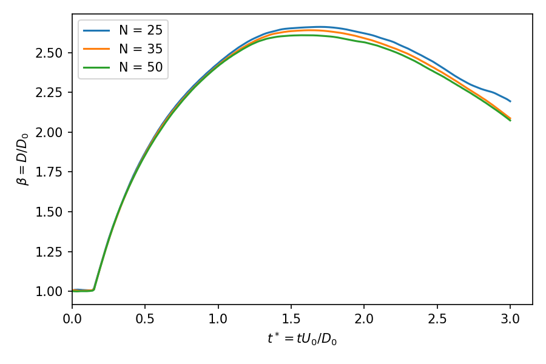

# droplet_impact_axisym

Water droplet (D0 = 2 mm) impacting a flat wall in air. 2D axisymmetric wedge, `interFoam` (VOF + MULES), OpenFOAM v2606.

## Run

```bash
./Allrun          # mesh -> checkMesh -> setFields -> interFoam (4 cores) -> beta(t)
NP=1 ./Allrun     # serial
./Allclean        # reset
./runMeshStudy    # N = 25, 35, 50 cells per radius -> ../meshStudy/beta_t_mesh.png
./runSweep        # We sweep: U0 = 0.5 ... 2.5 m/s -> ../sweep/betamax_We.png
```

`Allrun` sets `endTime` (from `tStarEnd`) and `maxDeltaT` (0.6 × capillary time-step limit for the current mesh) automatically.

All physical and mesh inputs are in `caseParameters`.

## Setup

| Item | Value |
|---|---|
| Domain | r = 0–6 mm, y = 0–8 mm, 5° wedge |
| Mesh (default) | 150 × 200, N = 25 cells per radius, dx = 40 µm |
| Fluids | water ρ = 1000 kg/m³, ν = 1e-6 m²/s; air ρ = 1.2, ν = 1.5e-5; σ = 0.072 N/m |
| Wall | no-slip, `constantAlphaContactAngle` θ = 90° |
| Top / outer | open: `totalPressure`, `pressureInletOutletVelocity`, `inletOutlet` |
| Time step | adaptive, Co ≤ 0.2, Δt ≤ 0.6 × capillary limit (5 µs at N = 25) |
| Run length | t* = tU0/D0 = 3 after contact (`tStarEnd`); use 5+ for recoil |

Default U0 = 1 m/s gives We = ρU0²D0/σ = 27.8, Re = U0D0/ν = 2000.

## Outputs

- `beta_t.csv`, `beta_t.png`: spreading factor β(t*) from the α = 0.5 isosurface, t* = tU0/D0 from contact
- `log.spreading`: β_max compared with Clanet et al. (2004), Pasandideh-Fard et al. (1996), Roisman (2009)
- `postProcessing/liquidVolume`: liquid volume history (mass conservation check)
- `case.foam`: open in ParaView, colour by `alpha.water`

## Results (We = 27.8, Re = 2000, θ = 90°)

| Mesh | Cells per R | Δx (µm) | β_max | t*_max | vs Pasandideh-Fard |
|---|---|---|---|---|---|
| N25 | 25 | 40 | 2.661 | 1.70 | −1.2 % |
| N35 | 35 | 29 | 2.640 | 1.63 | −2.0 % |
| N50 | 50 | 20 | 2.608 | 1.57 | −3.2 % |

Clanet (2004) gives 2.07 and Roisman (2009) gives 2.39. β_max is independent of domain height (2.661 with 4 mm and 8 mm domains at N = 25).

**Early spreading (t* < 1) is mesh-independent, but β_max does not converge.** Differences near maximum spread grow with refinement (0.021, then 0.032), while recoil converges (N35 and N50 differ by 0.015 at t* = 3). Two mechanisms fit, both of which make coarse meshes overpredict spreading:

1. Numerical contact-line slip: on a no-slip wall the contact line moves by about one cell, so contact-line dissipation grows as Δx decreases.
2. Under-resolved wall boundary layer: δ ≈ D0/√Re ≈ 45 µm, only 1 cell at N25 and 2 cells at N50, so wall shear is underestimated.

Planned tests: a wall-graded mesh (Δy ≈ 5 µm at the wall, same Δx) and a fixed Navier slip length.



## Known limitations

- No-slip wall: contact-line motion relies on numerical slip, so β depends on the mesh (see Results).
- Static contact angle: a dynamic contact-angle model is the next step (Phase 2–3).
- Recoil at θ = 90° drives a thin axial jet, rising at about 4 m/s (4 U0) and reaching 7.2 mm. Liquid volume is conserved to 0.0002 % up to t ≈ 6.6 ms in both a 4 mm and an 8 mm tall domain. Loss begins at t ≈ 7.4 ms in both, while the jet tip is still near 1.4 mm, so it comes from the under-resolved jet (a few cells wide), not from the boundary. Outflow through the top of the 4 mm domain roughly doubled it (−0.18 % vs −0.085 % at 10 ms). β_max = 2.661 in both domains. Validation runs therefore stop at t* = 3.
- Initial droplet is set with `setFields` (staircase interface at N = 25).
